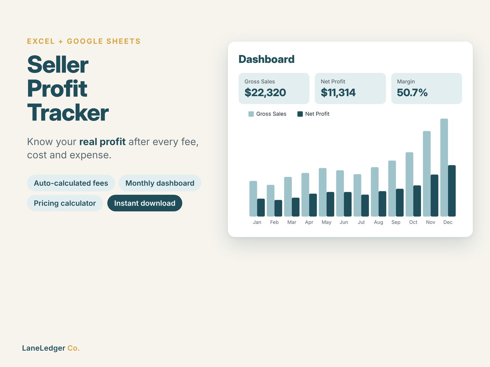
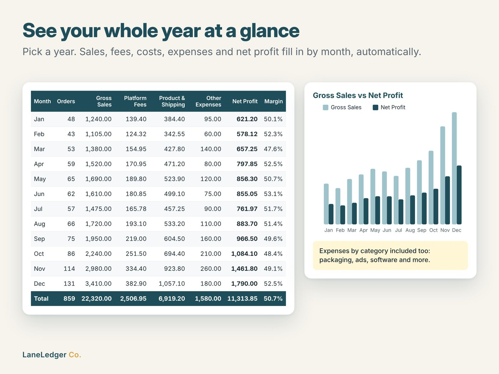
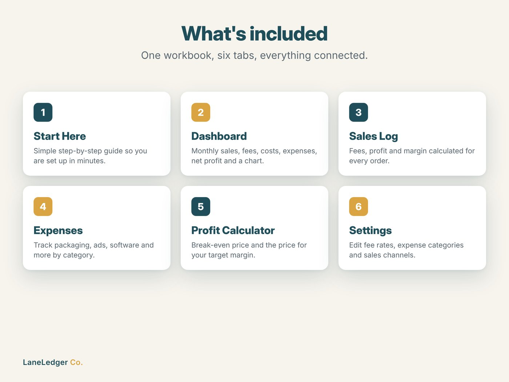
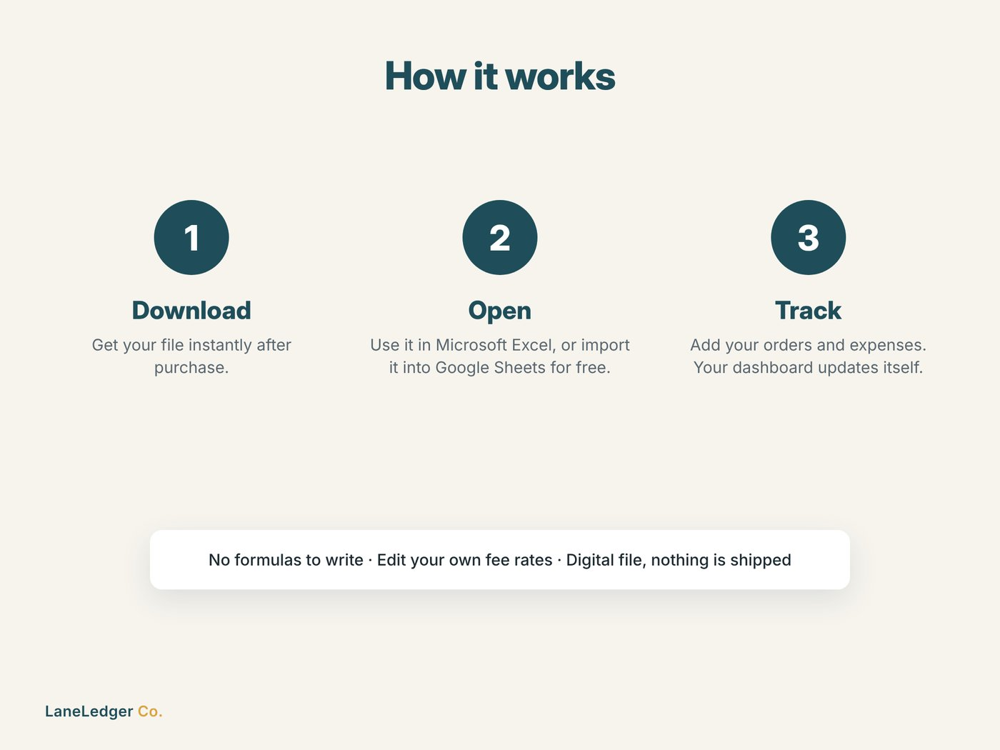

# Seller Profit Tracker

A 6-tab Excel / Google Sheets workbook that shows small online sellers their **real profit** after platform fees, costs and expenses.

**[View on Etsy](https://www.etsy.com/listing/4602364714/seller-profit-tracker-spreadsheet-etsy)** · **[Download the free demo](demo/Seller_Profit_Calculator_FREE_DEMO.xlsx?raw=1)** · Part of [LaneLedger Co.](https://github.com/EkremHakanSevil/laneledger-spreadsheet-tools)

🎬 **[Watch the 13-second product video](video/product_video.mp4)**

## Features

- **Sales Log** – enter price, quantity and costs; gross sale, platform fees, net profit and margin are calculated per order (500 rows)
- **Settings** – editable fee rates: listing fee, transaction fee, payment processing (% + fixed), currency conversion; expense categories and sales channels
- **Profit Calculator** – profit, break-even price and the price needed for a target margin
- **Expenses** – business costs by category with dropdowns
- **Dashboard** – pick a year to see monthly orders, sales, fees, costs, expenses, net profit and margin, with a chart and expenses by category

| Dashboard | Profit calculator | Sales log |
|---|---|---|
|  |  |  |

| What's included | How it works |
|---|---|
|  |  |

## 🎁 Free demo

[`Seller_Profit_Calculator_FREE_DEMO.xlsx`](demo/Seller_Profit_Calculator_FREE_DEMO.xlsx?raw=1) includes the Profit Calculator and fee settings. Open it in Excel or import it into Google Sheets (File → Import → Upload).

The [full version](https://www.etsy.com/listing/4602364714/seller-profit-tracker-spreadsheet-etsy) adds the Sales Log, Expenses and the yearly Dashboard.

## How it was built

| Area | Details |
|---|---|
| Generation | Python + `openpyxl`: workbook generated from code with styling, data validation, conditional formatting, a chart and ~2,100 formulas |
| Formulas | `SUMIFS`, `COUNTIFS`, `IFERROR` and closed-form break-even / target-margin pricing that accounts for percentage and fixed fees |
| Testing | Headless LibreOffice recalculation (zero formula errors) plus hand-checked fee, profit and pricing cases |
| Images | HTML/CSS templates rendered to 2000×1500 listing images with Playwright |

**AI-assisted:** Built in collaboration with Anthropic's Claude. I made the product and business decisions, reviewed and tested the workbook and ran the Etsy listing; Claude helped with code generation, design and copywriting. The Etsy listing discloses AI use as required by Etsy's Creativity Standards.

---
*Screenshots, documentation and a free demo only. The full workbook is sold on Etsy.*
